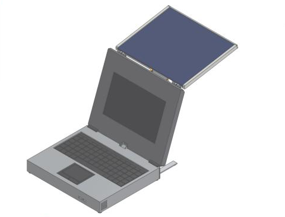
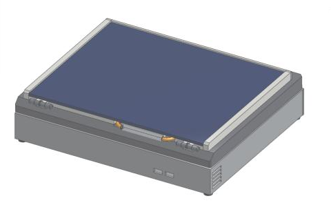
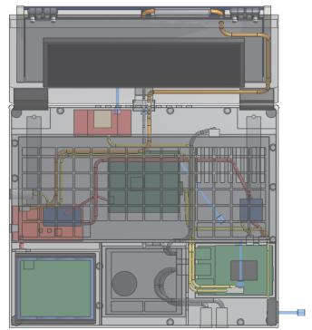
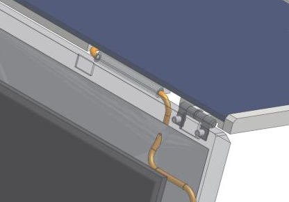
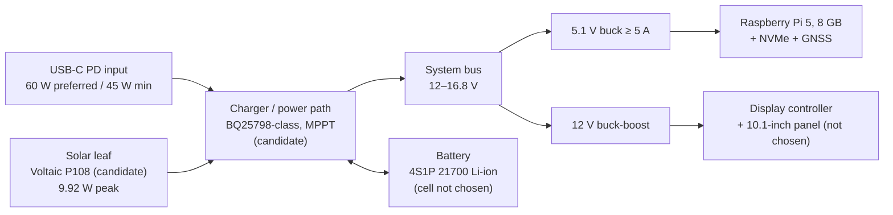

# NOMAD

**A portable, offline-first field computer, engineered for the case where the infrastructure is gone.**

**Developer:** Angel Angelov. NOMAD is an independent engineering project.

> **Project status: V1 — Digital Prototype.** NOMAD exists today as specifications, parametric CAD, an integrated virtual V1 design, engineering studies and calculations.
> - **No hardware has been built, bought, printed or tested.** No complete physical build exists, so nothing here is physically validated.
> - The V1 Onshape model regenerates in the Part Studio `NOMAD V1 — Digital Prototype` of the NOMAD document, with one open build warning (below). It has been checked by CAD-kernel simulation only.
> - Numbers below are labelled with their source: published, calculated, estimated, modelled or assumed.

---

## The V1 digital prototype in Onshape



*Overview (pose 4): lid open at 110°, B1 solar leaf at 120° behind the display, rear stay deployed. The base holds the keyboard and trackpad.*

| Closed | Internal layout |
|---|---|
|  |  |
| *Pose 1, closed for transport.* The leaf is stowed on the lid back with the panel face up. The two USB-A ports (front right) and the fan exhaust grille (right wall) are visible. | *Pose 2, top view with X-ray, front at the bottom.* Visible: the battery bay (front left), the trackpad (front centre), the Raspberry Pi 5 stack (front right), the power board and display controller under the keyboard, the GNSS module in the rear strip, the cable routes and the airflow arrows. The open lid is at the top. |

| Solar-leaf hinge detail |
|---|
|  |
| *Pose 3 (leaf 90°), lid in X-ray.* One of the two TorqMaster SB-261 friction hinges on the lid's top edge. The orange solar lead runs from the leaf through the separate, non-structural cable sleeve on the hinge axis (R12 bends, no slip ring) into its channel in the lid. |

**What these images are:**
- They are genuine screenshots of the `NOMAD V1 Visual` feature in the NOMAD Onshape document. The feature is generated by FeatureScript from the integration model, and the poses are its own settings.
- They show the **digital design, not a built device**. Nothing has been printed or assembled, and fit, hinge torque, thermal and electrical behaviour are not physically validated.
- Component envelopes are labelled ENGINEERED, SELECTED or PLACEHOLDER in the model; several are placeholders (for example, the power board has no layout yet).
- Onshape currently reports one build warning on the feature: the base shell's exterior edge-chamfer cut fails, so the base edges are drawn sharp. The cavity and all internal geometry are built.
- The images were captured at browser-screen resolution.

Details: [`docs/V1-VISUAL-MODEL.md`](docs/V1-VISUAL-MODEL.md).

## Overview

NOMAD is a clamshell field computer meant to keep working with no grid power, no mobile network and no internet. The design brief is a self-contained machine that carries everything it needs:
- **compute and storage**
- **offline knowledge and maps**
- **GNSS navigation**
- **local AI**
- **a display and controls**
- **a removable battery**
- **a deployable solar panel**

It is meant to be a working tool, not a decorative cyberdeck. The project is in **Virtual V1**: the rule is to finish the virtual design (requirements, CAD, power and thermal architecture, BOM) before spending money on hardware. Then physical validation decides what survives.

## Design philosophy

> **Assume the infrastructure is gone.**

Design priorities, in order:
1. function
2. reliability
3. serviceability
4. modularity
5. mechanical simplicity
6. manufacturability
7. offline capability
8. expandability
9. aesthetics

Appearance never wins against the first eight.

What this means in practice:
- **Offline-first.** Core functions (compute, storage, maps, navigation, knowledge, local AI) must work with no network. This is a locked requirement (SYS-3).
- **Serviceable in the field.** The requirements call for a removable, never-sealed battery, no glue, replaceable modules and a small standard fastener family (M2.5 / M3 with heat-set inserts).
- **Simple mechanisms.** The design is manual only, with no motors and no slip rings. A simple, robust mechanism is preferred over a clever one.
- **Honest energy claims.** Solar is a field *replenishment* system, not the primary power source (SYS-10). No runtime figure is quoted without a power budget and a solar-yield model behind it.
- **Evidence labelling.** Values are tagged as published (manufacturer data), calculated, estimated, modelled in CAD, or measured. Nothing is measured yet.

## Capabilities

### Being engineered now (virtual design)

| Area | Where it stands |
|---|---|
| Mechanical architecture | Clamshell base + display lid; solar architecture **B1** selected (D-010) |
| Virtual V1 integration | Candidate hardware placed in the B1 clamshell. Layout, power, battery, thermal, display hinges, harness, mass/CG, stability, DFM and BOM are checked (58 PASS / 8 WARN / 0 FAIL, *calculated / estimated*). The layout is **proposed** as D-011 and not yet accepted: [`docs/V1-VIRTUAL-INTEGRATION.md`](docs/V1-VIRTUAL-INTEGRATION.md), audit [`docs/V1-AUDIT-2026-10-06.md`](docs/V1-AUDIT-2026-10-06.md) |
| V1 visual master (Onshape) | One FeatureScript feature builds the whole V1 in 10 inspection poses, with every part tagged ENGINEERED / SELECTED / PLACEHOLDER / CONFLICT. It is checked in the Onshape kernel (*modelled*), and it is an inspection model, not production CAD: [`docs/V1-VISUAL-MODEL.md`](docs/V1-VISUAL-MODEL.md) |
| Solar leaf (B1) | Hinge-rail geometry modelled around the SB-261 hinge and checked in Onshape; panel and hinge candidates characterized from manufacturer data |
| Power architecture | Baseline topology, battery pack, charger, rails and runtime model **calculated** (E-POWER-002); to be implemented from TI reference design TIDA-050047 ([`docs/V1-POWER-DECISION-2026-10-08.md`](docs/V1-POWER-DECISION-2026-10-08.md)) |
| Hardware selection | Integration candidates characterized from datasheets; only the compute board is selected |
| Requirements | V1 requirements sheet with a status on every item ([`docs/v1-requirements.md`](docs/v1-requirements.md)) |

### Planned (not started)

- **Software:** launcher, offline maps, navigation, offline knowledge base, local AI, power management, system tools. The `software/` folders are empty placeholders.
- **Communications hardware:** in scope, not yet specified.
- **Physical work:** printing and testing the designed test coupons, mock-ups, then the first build.

## System architecture (design intent)

The diagram shows the **baseline power and system architecture from E-POWER-002**. It is a design on paper: no part of it has been built, and most parts are candidates, not selections.



| Subsystem | Baseline | Status |
|---|---|---|
| Compute | Raspberry Pi 5, 8 GB, active cooling | **Selected** |
| Storage | 500–512 GB NVMe (2230) via the Raspberry Pi M.2 HAT+ | Target / candidate |
| Display | 10.1", 1920×1200. Two directions remain: eDP panel + controller (D-A) or LVDS panel + controller (D-W) | Candidates; owner decision pending |
| Input | Low-profile wired USB keyboard; trackpad centred below it on the centreline (D-003) | Candidates; no keyboard yet meets the ≤ 8 mm target |
| GNSS | SparkFun GNSS Flex pHAT, u-blox DAN-F10N (L1/L5) | Candidate |
| Battery | 4S1P 21700 Li-ion, ≤ 92 Wh, removable | Topology baseline; cell not chosen |
| Charging | USB-C PD primary; solar on a second, MPPT input | Baseline; parts not chosen |

Full candidate data: [`docs/hardware.md`](docs/hardware.md).

## Mechanical design

- **Form factor:** a clamshell.
  - The base holds the keyboard, trackpad, compute, electronics and battery.
  - The lid holds the 10.1" display, with the solar leaf behind it.
  - Virtual V1 envelope: base 306 × 253 × 40 mm, lid 31 mm including the B1 leaf zone. Estimated mass 3.03 kg (range 2.52–3.54). All three figures are *calculated / estimated* and belong to the proposed D-011 layout.
  - Ports: there are no rear plugs. USB-C charging and the power button sit on the left wall, 2 × USB-A at the front right, and the fan exhaust on the right wall.
- **Parametric pipeline:**
  - All uncertain dimensions are named parameters in [`CAD/parameters/nomad.yaml`](CAD/parameters/nomad.yaml) (D-002). Each carries a status (verified / derived / provisional / TBD) and a source.
  - A script generates the FeatureScript parameter blocks from it, so CAD values are never hand-edited.
- **CAD:** Onshape is the geometry master. Geometry is generated with FeatureScript (D-001), and snapshots are kept in [`CAD/featurescript/`](CAD/featurescript/). The V1 visual master is generated from the integration model by [`CAD/tools/v1_visual_emit.py`](CAD/tools/v1_visual_emit.py).
- **Modelling levels:** envelope, then interface (holes, bosses, connectors, clearances), then detail. Detail is added only where it affects fit, motion, strength, assembly, manufacturing, cable routing or cooling.
- **Manufacturing target:** FDM PETG (ASA where parts face the sun), metal for shafts and pins, heat-set inserts for serviced joints.
- **Display hinges:** provisional axis at the base rear face (D-006). The candidate is 2 × Southco E6-10-216-50. The torque variant is not to be bought until the printed lid has been weighed (audit W8).
- **Base layout:** a placement and service architecture is *proposed* (D-007 / D-011) and not accepted.

## Solar system — architecture B1

Two solar architectures were studied in depth and compared:
- **A:** two cassettes that slide out sideways and tilt.
- **B1:** one rigid leaf hinged behind the display lid.

The owner selected **B1** on 2026-10-01 (D-010). Architecture A's records are kept as engineering history in [`prototypes/P0.1/`](prototypes/P0.1/) and [`docs/decisions.md`](docs/decisions.md).

**Why B1:**
- A's panel cable had to cross a structural rail wall, with tight bends.
- A's hub bracket fell below its safety-factor target (*calculated*).
- A's ±80° hard stops were not packaged in the design.
- A needed precision metal parts and custom-size laminates.

**B1 concept (design intent):**
- A rigid leaf covers the lid back and swings 0–190° on two constant-torque friction hinges.
- It is meant to aim at a sun overhead or behind the user, and to charge while the machine is closed.
- Candidates:
  - **Voltaic P108** panel: 9.92 W peak, 328 g (*published*).
  - **TorqMaster SB-188-SB-261-6** hinges.
- One panel cable is routed in a sleeve near the hinge axis (bend radius ≥ 12 mm, twist along the axis). There is no slip ring.

**Rear stay:**
- A fold-out rear stay is **mandatory**.
- Tipping onset is 2.4–8.3 m/s wind without the stay and 11.4–18 m/s with it (*calculated*).

**Hinge rail:**
- The SB-261 hinge rail was modelled around geometry measured from the vendor's IGES file and checked in an Onshape scratch model.
- Hinge torque margin is SF ≈ 1.16: published torque 0.96–1.13 N·m per hinge vs 0.83 N·m required (*published vs calculated*).
- That margin is thin. It is the first thing the physical coupon must check.
- Record: [`prototypes/B1_SB261/`](prototypes/B1_SB261/).

**Expected solar yield** for Sofia, into the battery (PVGIS 5.3 hourly data 2018–2023, 85 % charge chain *assumed*, *calculated*):

| Condition | Wh/day | Share of a 6 h normal-use day |
|---|---:|---:|
| Summer median, panel out all day | ≈ 48 | ≈ 91 % |
| Annual mean | ≈ 36 | ≈ 68 % |
| Winter median | ≈ 16 | ≈ 30 % |
| Winter worst-decile day | ≈ 5 | ≈ 10 % |

Solar is significant in summer, useful in winter and marginal on bad winter days. It cannot carry the instantaneous load: the panel's 9.92 W peak is below every calculated load state. Details: [`docs/solar.md`](docs/solar.md), [`docs/E-POWER-RESEARCH-CAMPAIGN.md`](docs/E-POWER-RESEARCH-CAMPAIGN.md).

## Power system

The power baseline ([`docs/E-POWER-002-POWER-ARCHITECTURE.md`](docs/E-POWER-002-POWER-ARCHITECTURE.md)) is entirely **calculated from manufacturer data**. No part has been bought or measured.

**Why 4S1P:**
- Only four 21700 cells fit the working battery bay, so 1S4P, 2S2P and 4S1P carry the same energy.
- 4S gives the lowest battery current (≤ 2.6 A worst case, *calculated*).
- 4S needs a buck-boost charger: a buck-only MPPT cannot fully charge 4S from a hot P108 (*inferred* from manufacturer data). The baseline charger is buck-boost.

**Runtime target:** 6 h normal use, 4 h minimum (owner requirement).

**Runtime model** (display direction D-A, normal use, *calculated*):

| Cell basis | Pack | New | End of life | 6 h target with 10 % reserve |
|---|---|---:|---:|---|
| Molicel M65A (preliminary datasheet) | ≈ 92 Wh | 9.3 h | 7.4 h | Met |
| Samsung 50E-class | ≈ 71 Wh | 7.2 h | 5.8 h | Not met (4 h minimum met) |

**Protection (requirements baseline; parts not chosen):** a standalone protector BMS (over/under-voltage, over-current, short-circuit, temperature) and a 10 A fuse on the pack. The pack must stay removable.

## Development method

NOMAD is developed as a documented engineering process rather than a build log of finished hardware.

- **Decisions are recorded.**
  - Every architectural choice goes into [`docs/decisions.md`](docs/decisions.md) with the problem, the alternatives, the tradeoffs and the outcome.
  - Superseded decisions are kept, not deleted.
- **There is an approval gate.**
  - Architecture, mechanism, battery location, layout and scope changes need the project owner's explicit approval.
  - Studies present options; they do not choose.
- **Analysis is scripted.**
  - Studies are small Python scripts using only the standard library, in [`CAD/tools/`](CAD/tools/) and [`prototypes/`](prototypes/).
  - They are written to reproduce the numbers in their reports, and several have `--check` modes that verify generated CAD blocks are current.
  - Key geometry results are cross-checked against the Onshape geometry kernel in scratch models.
- **Evidence is labelled.**
  - Claims are tagged *published / calculated / estimated / modelled (kernel) / assumed*.
  - Errata are added to reports when a later study corrects an earlier one.
- **AI assistance is used openly.**
  - Requirements, CAD scripts, FeatureScript, studies and documentation are produced with AI assistants, including Claude Code, working through a FeatureScript-only Onshape connection under the owner's direction.
  - The owner makes every decision. [`CLAUDE.md`](CLAUDE.md) holds the working rules given to the assistant.
  - Some reports mention the assistant's working environment (scratch documents, API usage).

## Current status

| Item | Status |
|---|---|
| Phase | **V1 — Digital Prototype** (Virtual V1 integrated; physical validation not started) |
| Architecture | B1 **locked** (D-010, 2026-10-01) |
| V1 requirements | Written, with a status on every item |
| Virtual V1 integration | Done virtually (2026-10-06); layout **proposed** as D-011, owner decisions pending (§19 of the integration report) |
| Power architecture | Baseline done (E-POWER-002); implementation route chosen (TI TIDA-050047); cell and pack style still open |
| Onshape CAD | **V1 visual master** (Feature Studio `NOMAD_V1_Visual`): kernel-checked across 10 poses on 2026-10-08 and regenerating in the Part Studio `NOMAD V1 — Digital Prototype`, with one open build warning (base edge chamfers); inspection model, not production CAD. Also P0.1 test coupons and older Architecture A / Round E models (history), and the isolated D-010 concept model |
| Physical prototypes | **None.** Test coupons are designed but not printed; the physical test plan is defined but not run |
| Software | **Not started** |

### Still requires physical testing

Nothing below can be closed in CAD or by calculation:
- **Solar-leaf hinge (SB-261):** the torque margin (SF ≈ 1.2 on published torque) and its behaviour across temperature. This needs the coupon test.
- **Display hinges (Southco E6):** the torque variant, after weighing the printed lid and display.
- **B1 stability:** tipping with and without the rear stay, and in wind.
- **Cable twist:** the solar-lead sleeve over 0–190° of cycling; the display-hinge knuckle.
- **Thermal:** SoC temperature under sustained load in the printed base. The model predicts throttling above about 31 °C ambient.
- **Battery and power electronics:** the pack build, BMS, charger / MPPT behaviour and runtime (all *calculated* today).
- **Fit:** the keyboard thickness (manual 16 mm vs product page 21 mm), the P108 in the leaf rebate (274 mm panel vs 273 mm rebate), and the print-bed split of the large parts.

## Open engineering questions

These are open, and the requirements sheet tracks them:
- **Battery cell:** M65A-class (its runtime depends on a preliminary datasheet) or a mature 50E-class cell (misses the 6 h target at end of life).
- **Battery bay:** a tightly bonded pack in 90 × 82 × 30 mm, or a holder-type pack that needs about 93.6 × 82 × 31 mm.
- **Display path:** eDP (D-A) or LVDS (D-W). D-W misses 6 h at end of life with reserve.
- **Thermal limits:**
  - The M.2 HAT+ is rated to 50 °C ambient, so internal air must stay ≤ 50 °C. The model gives a maximum ambient of 43.5 °C at normal load (*calculated*).
  - Closed-lid solar charging heats the display (+15–22 K even with the vented gap and foil, *estimated*).
- **Base layout and I/O** (D-007 / D-011, proposed).
- **Printing access:** large parts exceed a 256 mm bed. They need either split lines or a print service.
- **Leaf-table contact:** with the lid past about 120°, the leaf can reach the table. This is a known B1 limit; the operating rule is to open the leaf first.
- **Operating temperature range, final port list, audio:** not yet decided.

## Roadmap

The steps follow the V1 dependency order. No dates are committed.

1. ~~B1 architecture formalization~~ (done)
2. ~~V1 requirements~~ (done)
3. ~~Hardware envelope down-select, first pass~~ (done; conflicts open)
4. ~~Power budget, preliminary~~ (done)
5. ~~Battery / power architecture baseline~~ (done; owner decisions pending)
6. ~~Thermal architecture~~ (done virtually)
7. ~~Re-baseline the parameters~~ (done; the V1 master is `nomad.yaml`)
8. ~~Resolve the display hinge / rear-port conflict~~ (no rear plugs in the proposed layout)
9. ~~Integrate the complete Virtual V1~~ (done virtually; D-011 proposed; Onshape visual master)
10. ~~Mass, centre of gravity and stability analysis~~ (*calculated / estimated*)
11. ~~BOM and pricing~~ (preliminary, ≈ €1,405 prototype, approximate prices)
12. Owner decisions (D-011, cell, display, print access), then staged purchasing, starting with the validation parts
13. Physical validation: hinge coupon, tipping, thermal, cable-twist and fit tests
14. Physical build, then software bring-up

## Repository structure

| Path | Contents |
|---|---|
| [`docs/`](docs/) | Specifications: requirements, architecture, mechanical, hardware, power, solar, decisions, build log |
| [`CAD/parameters/`](CAD/parameters/) | `nomad.yaml`: master mechanical parameters |
| [`CAD/featurescript/`](CAD/featurescript/) | FeatureScript sources and snapshots of the Onshape Feature Studios, plus scratch test harnesses |
| [`CAD/tools/`](CAD/tools/) | Parameter pipeline and engineering-study scripts |
| [`CAD/coupons/`](CAD/coupons/) | Test-coupon generators (STL/SCAD outputs are generated locally, not committed) |
| [`prototypes/P0.1/`](prototypes/P0.1/) | P0.1 study reports (Rounds A–E, D-010 solar comparison) |
| [`prototypes/B1_SB261/`](prototypes/B1_SB261/) | B1 solar-leaf hinge-rail record, coupon spec, validation status |
| [`prototypes/V1/`](prototypes/V1/) | Hardware and energy characterization, power calculation scripts |
| `hardware/`, `software/`, `media/`, `prototypes/P0.2/`, `prototypes/P1/` | **Empty placeholders** for future work |

[`CAD/README.md`](CAD/README.md) explains the CAD workflow and the Onshape elements.

## Tools

- **Onshape** with **FeatureScript**: parametric CAD.
- **Python 3**, standard library only: parameter pipeline, geometry and load studies, power and runtime models.
- **EU JRC PVGIS 5.3**: solar-yield data.
- **Git / GitHub**: version history.
- **Claude Code**: AI-assisted engineering, CAD scripting and documentation.

To check that the generated CAD parameter blocks match the YAML (on Windows `py`, elsewhere `python3`):

```bash
py CAD/tools/yaml_to_featurescript.py --check
```

To reproduce the power-architecture numbers:

```bash
py prototypes/V1/epower_architecture_calc.py
```

## Project status and disclaimer

NOMAD is an independent engineering project by Angel Angelov, published as **V1 — Digital Prototype**.
- Nothing here has been physically built, tested or measured.
- Calculated and modelled results can be wrong in ways that only hardware will reveal.
- Physical testing is authoritative for fit, motion, strength and thermal behaviour.
- Component names are candidates under evaluation, not endorsements.

NOMAD is a general-purpose civilian field computer. It is not a weapon and has no weapons-related function.
